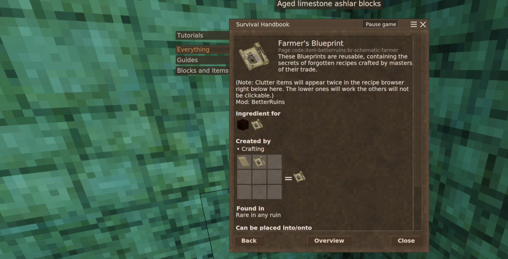

# Nf3t - Copy Better Ruins Schematics

Mod URL: [https://mods.vintagestory.at/show/mod/47272](https://mods.vintagestory.at/show/mod/47272)

Allows players to duplicate Better Ruins blueprints / schematics using parchment.

Requires [Better Ruins](https://mods.vintagestory.at/betterruins). It adds one recipe (a content-only mod, no code): combine a sheet of parchment with a Better Ruins schematic (`betterruins:br-schematic-*`) and you get a second copy of the same schematic. The original is not consumed.
