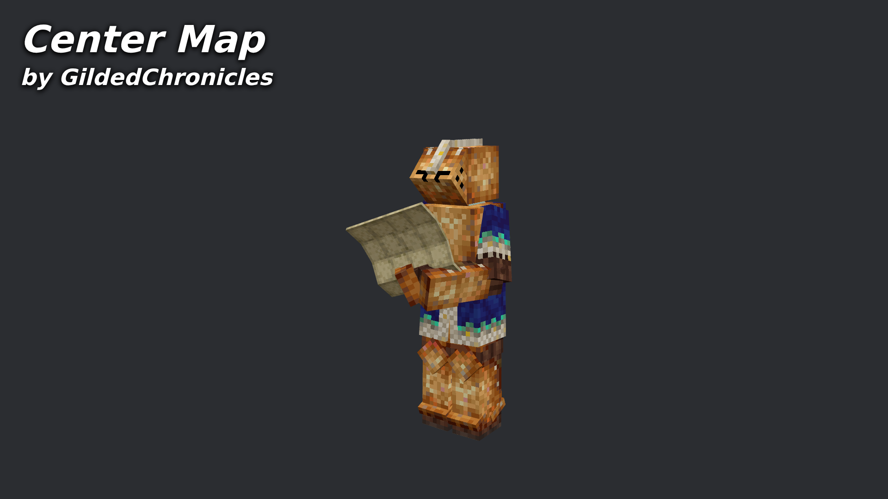

# Nf3t - Center Map

Mod URL: [https://mods.vintagestory.at/nf3tcentermap](https://mods.vintagestory.at/nf3tcentermap)

Adds a command to center the map at a specific coordinate, and mark it with a temporary marker that disappears when the map is closed.

## Commands

* `.panmap <x> <y> <z> [name]`, for example `.panmap 100 80 -300 Old mine`. Centres the map **if it is already open** and marks the spot (the marker is called "Panmap" without a name). It never opens the map by itself. If the map is closed it says so and gives you a link to open it at that location; if it is open it centres the map and says so. Either way it adds a link to share the location with other players (see below). Coordinates are shown relative to the world spawn, like the map and the coordinate arguments of commands; the height is the real height.
* `.panmapshare [x y z] [name]`: shares a location with everyone on the server. Without coordinates it shares your own position.

## Client only, or with a server

The mod works fine client-only (it is not required on the server, or on other players' clients). If the mod is also on the server, shared locations are sent as network packets and every player who has the mod gets a clickable link in chat ("Name shared a location: [x, y, z]"). Players without the mod see nothing. The server fills in the sender's name itself, strips markup from names, and limits sharing to once every two seconds per player. Without the mod on the server, `.panmapshare` says that the server doesn't support it.
