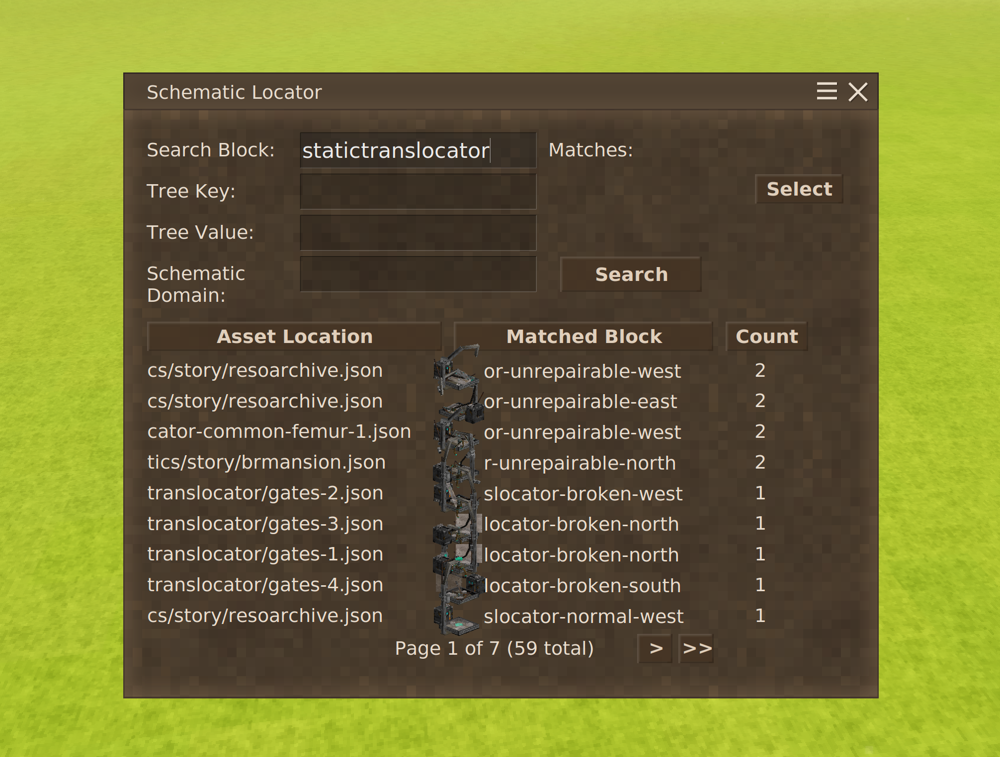

# Nf3t - Schematic Search (Draft)

Mod URL: [https://mods.vintagestory.at/schematicsearch](https://mods.vintagestory.at/schematicsearch)

You know when you are watching a YouTuber explore a structure you have never seen before? Well now if you can identify a few unique blocks, you can search for a particular structure starting with a specific block!

Default to "Schematic Locator" open Ctrl + Y. Can be changed in settings.
For blocks like tapestries, and you know anything about the BlockEntity's AttributeTree values, you can further refine your search!

## Finding structures already generated

The game records every structure worldgen places in its map region (a box and a code such as
`s-kitchen1.json/undergroundruin`), and saves that with the world. Two server commands (admin only: `controlserver`) read it:

| Command | What it does |
| --- | --- |
| `/liststructures [radius]` | Every kind of structure within the radius (default 1000 blocks): how many, and how far and which way the nearest is |
| `/findstructure <filter> [radius]` | The 25 nearest structures whose code contains the filter (or matches a pattern with `*`, e.g. `*shrine*`), ignoring case, with their position as the coordinates HUD shows it and an absolute `/tp` to above their middle |

Only map regions loaded now (near players) are searched, and only land that has been generated has structures. Run from
the server console, they search around the world spawn.

## How parsing is done

| Data Structure    | Key Type              | Value Type            | Purpose                                                  |
|:------------------|:----------------------|:----------------------|:---------------------------------------------------------|
| **BlockCodes**    | `int` (Palette ID)    | `AssetLocation`       | Defines **what** the block is (e.g., `game:log`).        |
| **BlockIds**      | `int` (Index $i$)     | `int` (Palette ID)    | Stores the ID of the block at specific position $i$.     |
| **Indices**       | `int` (Index $i$)     | `uint` (Packed Coord) | Stores the X/Y/Z coordinate at specific position $i$.    |
| **BlockEntities** | `uint` (Packed Coord) | `string` (JSON)       | Stores custom data for a block at a specific coordinate. |

## Current changelog

- Chat wasn't sent due to rate limiting

## TODO

- Readopt Utils.MatchAssetLocation when it does caching. I'm thinking there should be a search object
- Search Prefix / Matched Block / Block + Entity Mode
- Make it so that tapestries render their blockentity type stuff so they show up!
- Arrow for scrolling through text that has been reduced. Or maybe clicking on "..." swaps whether its the start or end.
- Flicker through different block types?
