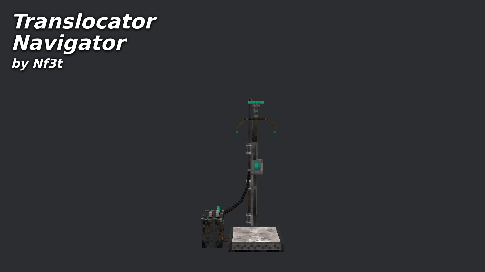

# Nf3t - Translocator Navigator

Mod URL: [https://mods.vintagestory.at/show/mod/39775](https://mods.vintagestory.at/show/mod/39775)

A client side mod that calculates the shortest path between your current position and a target, factoring in translocator jumps as "shortcuts."
## Navigator window

Press **Ctrl+T** (rebindable under Controls as "Translocator Navigator") or type `.tlnav` to open the navigator window.

- Enter a **Start** and a **Destination** in the coordinates the game shows (X and Z relative to spawn), or press
  **Here** to use your current position. **Swap** switches them around.
- **Find route** lists the route step by step, e.g. `1. Walk 340 m NE to translocator at 120, 72, -45`,
  `2. Teleport to -3010, 110, 880`, and shows how far the translocators save you. **Copy** puts a step's coordinates
  on the clipboard.
- **Start guidance** shows the current step at the top of the screen, with the distance and direction from where you
  are, and an arrow beside it that points the way relative to where you look (up is straight ahead). It moves on by itself when you reach each step (or come out of a translocator) and says when you have arrived.
  **Stop guidance** or `.tlnav stop` hides it.

Only translocators you have looked at are known to the mod, so look at the translocators along your way first.

## Commands

| Command        | Description                                                                         |
|----------------|-------------------------------------------------------------------------------------|
| `.tlnav`       | Opens the navigator window. `.tlnav stop` stops the on-screen guidance.             |
| `.pathtl`      | Shortest path to coordinates using known translocators, printed in chat.            |
| `.pathtlhist`  | Shortest path to the previously given target, printed in chat.                      |
| `.counttl`     | Counts the translocators seen by this mod in this world and across all worlds.      |
